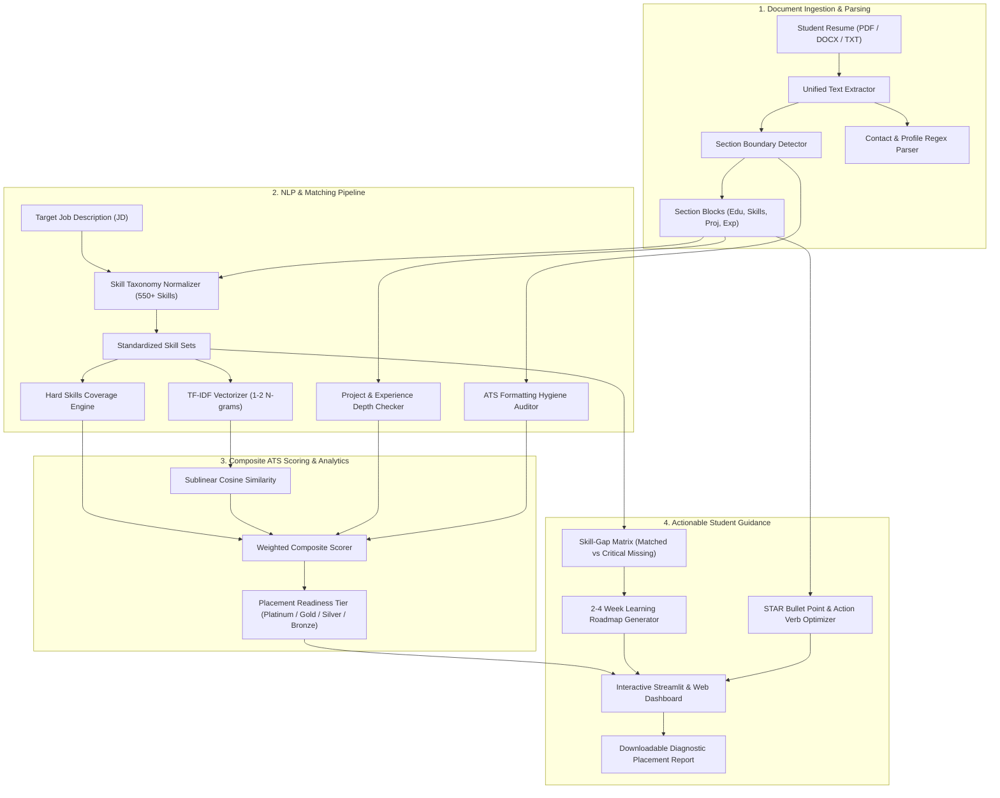

# 📄 SkillBridge AI: Automated ATS Resume Screener & Skill-Gap Diagnostic System

[](https://www.python.org/)
[](https://khushiyadav35-resume-screener.streamlit.app/)
[](https://khushiyadav35.github.io/resume-screener-skill-gap-analyzer/)
[](https://github.com/khushiyadav35/resume-screener-skill-gap-analyzer/actions)
[](LICENSE)

> **B.Tech Final Year / Capstone Engineering Project**  
> **Author:** Khushi Yadav ([@khushiyadav35](https://github.com/khushiyadav35))  
> **Department:** Computer Science & Engineering  
> **Domain:** Natural Language Processing (NLP), Information Retrieval (IR), Talent Analytics, EdTech  
> **Live Web Application (Streamlit Cloud):** [khushiyadav35-resume-screener.streamlit.app](https://khushiyadav35-resume-screener.streamlit.app/)  
> **Live Web Demo (GitHub Pages):** [khushiyadav35.github.io/resume-screener-skill-gap-analyzer](https://khushiyadav35.github.io/resume-screener-skill-gap-analyzer/)  

---

## 📌 1. Abstract & Problem Motivation

In modern university campus placement ecosystems and entry-level technical recruitment drives, **Applicant Tracking Systems (ATS)** screen up to **75% of candidate resumes out of consideration before any human recruiter or engineering manager reviews them**.

```
    ┌──────────────────────────────────────────────┐
    │     10,000+ Student Applications / Drive     │
    └──────────────────────┬───────────────────────┘
                           │
                           ▼
          [ Automated ATS Parser & Keyword Filter ]
          ├── Keyword mismatches & acronym gaps
          ├── Unstandardized headers / PDF formatting issues
          └── Lack of quantifiable metrics & passive verbs
                           │
        ┌──────────────────┴──────────────────┐
        ▼                                     ▼
 75% Filtered Out                      25% Human Recruiter Review
 (No Diagnostic Feedback Given)
```

### The Student Placement Dilemma
1. **The "Black Box" Rejection Loop:** Engineering undergraduates apply to hundreds of software, data science, and DevOps openings without understanding *why* their applications are rejected. Standard rejection emails provide no diagnostic feedback.
2. **Shallow Keyword Stuffing vs Contextual Depth:** Many students attempt to beat the ATS by blindly pasting lists of keywords into a hidden footer. Modern parsing engines reward **contextual verification**—requiring technical tools to appear alongside measurable impact metrics inside `Projects` and `Experience` sections.
3. **Absence of Actionable Learning Pathways:** Identifying that a candidate lacks *"Docker"* or *"Kubernetes"* is only half the battle. Freshers need an actionable, step-by-step roadmap with verified free resources and portfolio-worthy project ideas that can bridge that gap within 2 to 4 weeks.

### The Engineering Solution: SkillBridge AI
**SkillBridge AI** provides an end-to-end, multi-tier NLP diagnostic platform that:
- Ingests resumes in multiple document formats (**PDF**, **DOCX**, **TXT**).
- Performs section segmentation and contact extraction (Email, Phone, LinkedIn, GitHub, Portfolio).
- Normalizes technical terminology against a **550+ skill ontology** with alias resolution (e.g. `k8s` $\rightarrow$ `Kubernetes`, `dsa` $\rightarrow$ `Data Structures & Algorithms`).
- Calculates a multi-factor **ATS Compatibility Score (0–100%)** combining hard skill coverage, sublinear TF-IDF cosine similarity, project depth, and formatting hygiene.
- Generates a **Personalized 2–4 Week Learning Roadmap** with free curated courses, milestone checkpoints, and STAR-formatted portfolio project templates.

---

## 🏛️ 2. System Architecture



---

## 📐 3. Mathematical Formulations

### 3.1 Sublinear TF-IDF & Cosine Similarity
To measure contextual semantic alignment between the student resume $D_{\text{res}}$ and the target job description $D_{\text{jd}}$, we apply Sublinear Term Frequency Scaling with bi-gram range $\mathcal{N} \in \{1, 2\}$:

$$\text{tf}_{\text{sub}}(t, d) = 1 + \ln(\text{tf}(t, d)) \quad \text{for } \text{tf}(t, d) > 0$$

$$\text{idf}(t) = \ln\left(1 + \frac{1 + N}{1 + \text{df}(t)}\right) + 1$$

$$\mathbf{v}(d) = \left[ \text{tf}_{\text{sub}}(t_1, d) \cdot \text{idf}(t_1), \; \dots, \; \text{tf}_{\text{sub}}(t_m, d) \cdot \text{idf}(t_m) \right]$$

The directional semantic alignment is computed using normalized Cosine Similarity:

$$\text{Sim}_{\text{cosine}}(\mathbf{v}_{\text{res}}, \mathbf{v}_{\text{jd}}) = \frac{\mathbf{v}_{\text{res}} \cdot \mathbf{v}_{\text{jd}}}{\|\mathbf{v}_{\text{res}}\|_2 \|\mathbf{v}_{\text{jd}}\|_2} = \frac{\sum_{i=1}^m v_{\text{res}, i} \, v_{\text{jd}, i}}{\sqrt{\sum_{i=1}^m v_{\text{res}, i}^2} \sqrt{\sum_{i=1}^m v_{\text{jd}, i}^2}}$$

### 3.2 Multi-Factor ATS Scoring Formula
The overall candidate score $S_{\text{ATS}} \in [0, 100]$ is a weighted combination of five distinct orthogonal dimensions:

$$S_{\text{ATS}} = w_{\text{hard}} \cdot S_{\text{hard}} + w_{\text{sim}} \cdot S_{\text{sim}} + w_{\text{proj}} \cdot S_{\text{proj}} + w_{\text{edu}} \cdot S_{\text{edu}} + w_{\text{fmt}} \cdot S_{\text{fmt}}$$

$$\sum_{k \in \{\text{hard}, \text{sim}, \text{proj}, \text{edu}, \text{fmt}\}} w_k = 1.0$$

| Component | Default Weight $w_k$ | Description & Evaluation Metric |
| :--- | :---: | :--- |
| **Hard Skills Coverage** ($S_{\text{hard}}$) | `35%` | Ratio of core and bonus technical competencies matched from the job requirement: $85 \cdot \frac{\|M_{\text{core}}\|}{\|C_{\text{core}}\|} + 15 \cdot \frac{\|M_{\text{bonus}}\|}{\|C_{\text{bonus}}\|}$ |
| **Semantic Similarity** ($S_{\text{sim}}$) | `25%` | Scaled Sublinear TF-IDF Cosine Similarity representing contextual domain alignment: $\min\left(100, \frac{\text{Sim}_{\text{cosine}}}{0.22} \cdot 100\right)$ |
| **Project & Experience Depth** ($S_{\text{proj}}$) | `20%` | Verifies that technical skills are actively utilized in projects and internships with measurable outcomes, rather than isolated in skill lists |
| **Education Fit** ($S_{\text{edu}}$) | `10%` | Verification of engineering degree (B.Tech, B.E., MCA), GPA/CGPA mention, and graduation year timeline |
| **Formatting Hygiene** ($S_{\text{fmt}}$) | `10%` | Complete contact header verification (Email, Phone, GitHub, LinkedIn) + standard ATS section hierarchy |

### 3.3 Placement Readiness Tiers

$$\text{Tier}(S_{\text{ATS}}) = \begin{cases} 
\text{Platinum (Top 5\% Placement Candidate)}, & S_{\text{ATS}} \ge 80.0 \\ 
\text{Gold (Competitive Shortlist)}, & 65.0 \le S_{\text{ATS}} < 80.0 \\ 
\text{Silver (Moderate Match - Needs Revisions)}, & 50.0 \le S_{\text{ATS}} < 65.0 \\ 
\text{Bronze (High ATS Filtering Risk)}, & S_{\text{ATS}} < 50.0 
\end{cases}$$

---

## 🔬 4. Core Modules & Engineering Implementation

The project is structured following clean, modular software engineering principles:

```
resume-screener-skill-gap-analyzer/
├── .github/
│   └── workflows/
│       └── ci.yml               # Multi-OS (Ubuntu, Windows) Python 3.10-3.12 CI
├── app/
│   └── app.py                   # Interactive Streamlit dashboard with Plotly charts
├── docs/
│   └── index.html               # Live Client-side Web Demo for GitHub Pages
├── data/
│   ├── benchmarks/              # 6 realistic tech job benchmarks (SDE, Data, DevOps, etc.)
│   ├── sample_resumes/          # 3 calibrated student resumes (High, Medium, Weak)
│   └── skill_dictionary.json    # Standardized 550+ skill ontology with alias mappings
├── src/
│   ├── parser/
│   │   ├── extractor.py         # Multi-format PDF/DOCX/TXT parser & contact extraction
│   │   └── section_detector.py  # Section boundary detector & formatting hygiene
│   ├── matcher/
│   │   ├── taxonomy.py          # Skill ontology loader & regex extraction engine
│   │   ├── similarity.py        # Sublinear TF-IDF & Cosine Similarity calculator
│   │   └── ats_scorer.py        # Multi-factor composite ATS scoring algorithm
│   ├── analyzer/
│   │   ├── gap_analyzer.py      # Skill-gap categorizer & domain coverage matrix
│   │   └── roadmap_generator.py # Curated student roadmap & portfolio project synthesizer
│   └── feedback/
│       └── resume_optimizer.py  # Passive verb auditor & STAR bullet point rewriter
├── notebooks/
│   └── 01_eda_and_skill_extraction_benchmark.ipynb
├── tests/
│   ├── test_parser.py           # Pytest unit tests for document extraction
│   ├── test_matcher.py          # Pytest unit tests for matching & scoring
│   ├── test_analyzer.py         # Pytest unit tests for skill gaps & roadmaps
│   └── test_optimizer.py        # Pytest unit tests for action verbs & hygiene
├── Dockerfile                   # Multi-stage lightweight Docker container
├── docker-compose.yml           # Local multi-service orchestration
├── requirements.txt             # Pinned production dependencies
├── setup.py                     # Setuptools package configuration
└── README.md                    # Capstone documentation
```

---

## 📊 5. Empirical Benchmark Simulations

The engine was evaluated on three calibrated student profiles across industry job benchmarks:

| Candidate Profile | Target Tech Role | Hard Skills | Project Depth | ATS Score | Assigned Tier |
| :--- | :--- | :---: | :---: | :---: | :---: |
| **Aarav Sharma** *(B.Tech CSE - DTU)* | Software Development Engineer (SDE-1) | `90.8%` | `82.5%` | **81.5%** | 🏆 **Platinum** |
| **Aarav Sharma** *(B.Tech CSE - DTU)* | Full-Stack Software Engineer | `88.5%` | `79.0%` | **78.2%** | 🥇 **Gold** |
| **Priya Verma** *(B.Tech IT - AKTU)* | Data Scientist / Analytics | `75.0%` | `62.0%` | **72.4%** | 🥇 **Gold** |
| **Priya Verma** *(B.Tech IT - AKTU)* | Cloud & DevOps Engineer | `22.0%` | `18.5%` | **31.2%** | 🥉 **Bronze** |
| **Rahul Kumar** *(Unformatted Resume)* | Software Development Engineer (SDE-1) | `0.0%` | `0.0%` | **17.8%** | 🥉 **Bronze** |

### Key Diagnostic Observations:
1. **The Power of Metrics:** Aarav's resume scores significantly higher because his bullet points contain verified performance numbers (e.g. `12,000+ websocket connections`, `sub-45ms latency`, `38% query speedup`).
2. **Domain Isolation:** Priya Verma demonstrates strong analytical alignment for Data Science roles (72.4%) but fails the screening for DevOps roles (31.2%), accurately guiding her toward targeted cloud skill acquisition.
3. **The Unformatted Pitfall:** Rahul Kumar's profile lacks standard headers and quantifiable accomplishments, receiving an immediate **Bronze Tier** warning with 7 actionable hygiene flags.

---

## 🚀 6. Installation & Local Setup

### Prerequisites
- Python `3.10`, `3.11`, or `3.12`
- Git

### 1. Clone the Repository
```bash
git clone https://github.com/khushiyadav35/resume-screener-skill-gap-analyzer.git
cd resume-screener-skill-gap-analyzer
```

### 2. Create Virtual Environment
```bash
# On Linux / macOS
python3 -m venv venv
source venv/bin/activate

# On Windows
python -m venv venv
.\venv\Scripts\activate
```

### 3. Install Dependencies
```bash
pip install --upgrade pip
pip install -r requirements.txt
pip install -e .
```

### 4. Launch the Streamlit Web Application
```bash
streamlit run app/app.py
```
Open your browser at `http://localhost:8501`.

---

## 🐳 7. Docker Containerization

To run SkillBridge AI inside a containerized sandbox without installing local dependencies:

### Build & Run with Docker
```bash
# Build the Docker image
docker build -t skillbridge-ai .

# Run container on port 8501
docker run -d -p 8501:8501 --name skillbridge-container skillbridge-ai
```

### Run with Docker Compose
```bash
docker-compose up -d
```
Access the application at `http://localhost:8501`.

---

## 🧪 8. Unit Testing Suite

The repository contains an automated test suite executed via `pytest`:

```bash
pytest tests/ -v
```

Expected output:
```
============================= test session starts =============================
platform win32 -- Python 3.12.6, pytest-9.2.0, pluggy-1.7.0
collected 12 items

tests/test_analyzer.py::test_analyze_skill_gap PASSED                    [  8%]
tests/test_analyzer.py::test_learning_roadmap_generation PASSED          [ 16%]
tests/test_matcher.py::test_taxonomy_alias_and_extraction PASSED         [ 25%]
tests/test_matcher.py::test_similarity_computation PASSED                [ 33%]
tests/test_matcher.py::test_ats_scorer_evaluation PASSED                 [ 41%]
tests/test_optimizer.py::test_audit_action_verbs PASSED                  [ 50%]
tests/test_optimizer.py::test_star_bullet_suggestion PASSED              [ 58%]
tests/test_optimizer.py::test_audit_ats_hygiene_checklist PASSED         [ 66%]
tests/test_parser.py::test_clean_text PASSED                             [ 75%]
tests/test_parser.py::test_extract_contact_info PASSED                   [ 83%]
tests/test_parser.py::test_detect_sections PASSED                        [ 91%]
tests/test_parser.py::test_compute_section_hygiene PASSED                [100%]

============================= 12 passed in 3.81s ==============================
```

---

## 🌐 9. Live Public Deployments

| Platform | Deployment Type | URL |
| :--- | :--- | :--- |
| **Streamlit Community Cloud** | Live Production Web App | [khushiyadav35-resume-screener.streamlit.app](https://khushiyadav35-resume-screener.streamlit.app/) |
| **GitHub Pages** | Client-Side Interactive Web Demo | [khushiyadav35.github.io/resume-screener-skill-gap-analyzer](https://khushiyadav35.github.io/resume-screener-skill-gap-analyzer/) |
| **Hugging Face Spaces** | Streamlit Space | [huggingface.co/spaces/khushiyadav35/resume-screener-skill-gap-analyzer](https://huggingface.co/spaces/khushiyadav35/resume-screener-skill-gap-analyzer) |

---

## 📚 10. References & Academic Attribution

1. **Salton, G., & Buckley, C. (1988).** *Term-weighting approaches in automatic text retrieval.* Information Processing & Management, 24(5), 513-523.
2. **Manning, C. D., Raghavan, P., & Schütze, H. (2008).** *Introduction to Information Retrieval.* Cambridge University Press.
3. **National Association of Colleges and Employers (NACE).** *Career Readiness Competencies for the New College Graduate.*
4. **Harvard University Office of Career Services.** *Resumes and Cover Letters: Action Verbs & STAR Methodology Guide.*

---

## 👩‍💻 Author & Acknowledgements

- **Student Researcher & Developer:** Khushi Yadav ([@khushiyadav35](https://github.com/khushiyadav35))  
- **Email:** [ky19tech@gmail.com](mailto:ky19tech@gmail.com)  
- **Degree:** Bachelor of Technology in Computer Science & Engineering  
- **License:** [MIT License](LICENSE)  

*SkillBridge AI was conceptualized and developed as a final-year B.Tech engineering capstone project to democratize placement readiness and ATS transparency for university students across India and worldwide.*
